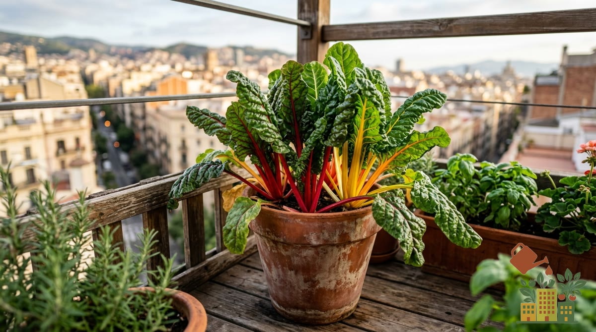

La acelga es de las hojas verdes más agradecidas para maceta: más resistente al calor que la espinaca, tolera bien el frío moderado, y con la técnica de recolección adecuada una sola planta puede seguir produciendo hoja durante varios meses seguidos.

<figure><figcaption>Acelgas de colores: muy productivas y vistosas en maceta</figcaption></figure>

*Este artículo contiene enlaces de afiliado. Si compras a través de ellos, podemos recibir una pequeña comisión sin coste adicional para ti.*

Si todavía no tienes semillas, aquí tienes semillas de acelga:

<a href="https://www.amazon.es/s?k=semillas+de+acelga&tag=mihuerto-herramientas-21" target="_blank" rel="sponsored noopener" class="btn-primary not-prose inline-block no-underline">Ver precio en Amazon</a>

## Maceta y sustrato

Una maceta de al menos 25-30 cm de profundidad, con un [sustrato universal de calidad](/articulos/mejor-sustrato-huerto-urbano-maceta/) rico en materia orgánica. La acelga es una planta de hoja con crecimiento continuo, así que agradece un sustrato bien nutrido desde el principio.

## Siembra

Se puede sembrar prácticamente todo el año en climas templados, evitando solo el pico de más calor del verano y las heladas más fuertes del invierno. Es una buena opción de siembra escalonada para tener hoja verde disponible casi todo el año.

## Luz

Rinde bien tanto con sol pleno como con semisombra (4-5 horas de sol directo), lo que la convierte en una opción válida para balcones sin la mejor orientación, a diferencia de hortalizas de fruto como el tomate o el pimiento.

## Riego

Mantén el sustrato con humedad constante, sin encharcar. La acelga tolera algo mejor los descuidos puntuales de riego que la espinaca, pero un riego muy irregular endurece las pencas y las hace más amargas.

## Cómo cosechar sin acabar con la planta

La clave está en cosechar hoja a hoja, no la planta entera: corta las hojas exteriores más grandes desde la base, dejando siempre el centro (las hojas más jóvenes) intacto. Así la planta sigue produciendo hojas nuevas durante meses, en vez de dar una única cosecha.

## Abonado

Al ser una planta de crecimiento continuo y cosecha prolongada, agradece un [aporte de abono](/articulos/mejores-fertilizantes-organicos-huerto-maceta/) cada 3-4 semanas durante la temporada de más producción, para mantener el ritmo de hojas nuevas.

## La acelga en un clima de interior

La acelga es la hoja verde que mejor lleva los extremos del interior peninsular: aguanta el verano mucho mejor que la espinaca o la lechuga y pasa el invierno en la maceta. Eso sí, en cada época se comporta distinto:

| Época | Cómo se comporta | Qué hacer |
|---|---|---|
| Marzo - mayo | Crecimiento fuerte | Mejor época de siembra; germina bien con el suelo por encima de unos 10 °C |
| Junio - agosto | Aguanta, pero sufre con 35 °C o más | Media sombra por la tarde y riego constante para que no amargue |
| Septiembre - octubre | Segundo empujón | Segunda siembra o trasplante para tener hoja todo el invierno |
| Diciembre - febrero | Casi se para | Las heladas fuertes queman las hojas exteriores; córtalas y rebrota desde el centro |

Como referencia, la acelga soporta heladas ligeras (hasta unos -2 °C) sin daños serios. En Toledo hay de media casi 10 días de helada en diciembre y casi 13 en enero (AEMET), así que en las noches más frías merece la pena acercar la maceta a la pared o taparla con una manta térmica.

Un truco de las acelgas en maceta: si al final del invierno la planta empieza a echar un tallo central alto (se sube a flor), ya no producirá más hojas buenas. Es el momento de sembrar una nueva.

## Problemas comunes

- **Hojas amarillas**: normalmente falta de nutrientes, dado el crecimiento continuo que exige a la planta un aporte regular.
- **Pencas duras y amargas**: riego irregular, sobre todo alternar sequía con riego abundante.
- **Planta que deja de producir**: puede indicar que se ha cosechado en exceso de golpe; deja siempre suficientes hojas centrales para que la planta se recupere.
- **Manchas marrones redondas en las hojas** (a veces agujereadas): suele ser cercospora, un hongo. Cómo reconocerla y tratarla en [manchas marrones en las hojas de la acelga](/articulos/manchas-marrones-hojas-acelga-cercospora/).

Si te interesa otra hoja verde con cuidados parecidos, consulta también nuestra guía de [cómo cultivar espinacas en maceta todo el año](/articulos/como-cultivar-espinacas-en-maceta/).

## Fuentes

- AEMET, [valores climatológicos normales de Toledo](https://www.aemet.es/es/serviciosclimaticos/datosclimatologicos/valoresclimatologicos?l=3260B&k=clm) (1981-2010).
- South Dakota State University Extension, [tolerancia a las heladas de las hortalizas comunes](https://extension.sdstate.edu/fall-frost-tolerance-common-vegetables).
