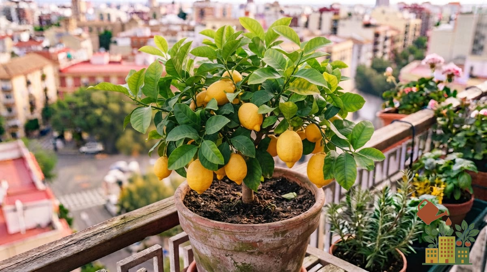

El limonero es, junto con el naranjo enano, el frutal más popular para cultivar en maceta en un balcón. Tiene dos rasgos que lo hacen distinto de otros cítricos: **florece varias veces al año** (así que puedes tener limones casi siempre) y es **el cítrico que peor aguanta el frío**. En un balcón del interior peninsular, con decenas de heladas cada invierno, eso decide casi todo lo demás.

<figure><figcaption>Limonero enano en maceta, cargado de fruto</figcaption></figure>

*Este artículo contiene enlaces de afiliado. Si compras a través de ellos, podemos recibir una pequeña comisión sin coste adicional para ti.*

Los cítricos no se cultivan desde semilla para dar fruto (tarda años y no garantiza la misma variedad): lo habitual es comprar directamente una planta joven ya injertada:

<a href="https://www.amazon.es/s?k=planta+de+limonero+en+maceta&tag=mihuerto-herramientas-21" target="_blank" rel="sponsored noopener" class="btn-primary not-prose inline-block no-underline">Ver precio en Amazon</a>

## Elige bien la variedad

Para maceta, busca plantas injertadas sobre un patrón enanizante o vendidas como "limonero enano" o "de maceta". Dentro de eso, la variedad cambia bastante el resultado:

| Variedad | Qué la distingue | Para quién |
|---|---|---|
| **Meyer** | Híbrido compacto, aguanta algo mejor el frío y da limones menos ácidos | La opción más fácil para maceta y para inviernos fríos |
| **Eureka** (a menudo vendido como "cuatro estaciones") | Casi sin espinas y florece varias veces al año | Quien quiere limones repartidos todo el año |
| **Lisboa** | Más vigoroso y espinoso, algo más resistente que el Eureka | Terrazas amplias |
| **Fino y Verna** | Las variedades clásicas españolas; Fino se recoge en otoño-invierno y Verna en primavera-verano | Si encuentras planta injertada en vivero |

## Tamaño de maceta

Empieza con una maceta de al menos 40-50 cm de diámetro y ve [trasplantando a una mayor cada 2-3 años](/articulos/como-cambiar-planta-a-maceta-mas-grande/), a medida que la planta crece. Un limonero adulto en maceta puede necesitar hasta 60-80 litros de sustrato.

## Sustrato

Usa un [sustrato específico para cítricos](/articulos/mejor-sustrato-huerto-urbano-maceta/) o un universal de calidad con buen drenaje, ligeramente ácido. Añadir un 20% de perlita ayuda a evitar el encharcamiento, al que los cítricos son especialmente sensibles.

## Luz y ubicación

El limonero necesita **el máximo sol posible**, idealmente orientación sur o el punto más soleado del balcón. Pegado a una pared que da al sur, además, recibe el calor que el muro acumula durante el día, lo que ayuda mucho en invierno.

## El frío: lo más importante en el interior

Es el cítrico más sensible al frío. Como referencia, a partir de unos **-3 °C deja de crecer**, entre **-4 y -6 °C se secan los brotes jóvenes** y las heladas fuertes y largas pueden matarlo. En maceta es más delicado que en el suelo, porque las raíces no tienen la tierra alrededor que las aísla.

Para hacerse una idea de lo que supone en el interior peninsular, estos son los días de helada de media en Toledo según AEMET (estación de Toledo, normales 1981-2010):

| Mes | Mínima media | Días de helada |
|---|---|---|
| Noviembre | 5,3 °C | 3,3 |
| Diciembre | 2,5 °C | 9,8 |
| Enero | 1,3 °C | 12,7 |
| Febrero | 2,6 °C | 6,9 |
| Marzo | 5,0 °C | 2,3 |

Unos 35 días de helada al año, concentrados de diciembre a febrero. En un balcón de ciudad suele helar menos que en la estación, pero hay que contar con ello. Qué hacer:

1. **De noviembre a marzo**, acerca la maceta a la pared más soleada y resguardada del viento.
2. **Aísla la maceta**: envuélvela con cartón, plástico de burbujas o una manta vieja, o súbela sobre unos tacos para que no toque el suelo frío.
3. **Las noches de helada**, cubre la copa con una [manta térmica antiheladas](/articulos/mejores-mallas-antiheladas-proteccion-invierno/) y retírala por el día.
4. **Riega menos en invierno**: un sustrato encharcado y frío daña antes las raíces.
5. Si se anuncia una ola de frío fuerte y puedes, **mételo dentro** unos días junto a una ventana (lejos del radiador).

Tienes más trucos en [cómo proteger el huerto del frío y las heladas en el balcón](/articulos/proteger-huerto-frio-heladas-balcon/).

## Riego

Riega cuando los primeros centímetros de sustrato estén secos, evitando tanto la sequía prolongada como el encharcamiento. En verano puede necesitar riego cada 2-3 días; en invierno, mucho más espaciado.

## Abonado específico para cítricos

Los limoneros son plantas muy exigentes en nutrientes. Usa un abono específico para cítricos rico en hierro y magnesio durante la primavera y el verano, siguiendo la dosis del fabricante. Consulta nuestra comparativa de [mejores fertilizantes orgánicos para huerto en maceta](/articulos/mejores-fertilizantes-organicos-huerto-maceta/) si prefieres una opción orgánica. Su ausencia es la causa más común de hojas amarillas con nervios verdes (clorosis férrica).

## Flores y frutos todo el año

A diferencia del naranjo, que florece sobre todo en primavera, el limonero (sobre todo Eureka y las "cuatro estaciones") puede tener a la vez flores, limones verdes y limones maduros. Los limones pueden quedarse en el árbol semanas después de madurar sin estropearse, así que recoge según los vayas necesitando. Si la planta es joven y carga demasiado, quítale parte de los frutillos para que no se agote.

## Poda

Poda a finales de invierno, eliminando ramas secas, cruzadas o que crezcan hacia el interior de la copa, para mantener una forma equilibrada y favorecer la entrada de luz.

## Problemas comunes

- **Hojas amarillas con nervios verdes**: falta de hierro, corrige con un abono específico para cítricos.
- **Caída de flores o frutos pequeños**: riego irregular o falta de nutrientes en el momento de la floración.
- **Cochinilla**: plaga frecuente en cítricos de maceta, revisa el envés de las hojas y los tallos periódicamente.
- **Hojas nuevas rizadas u onduladas**: probablemente [minador de los cítricos](/articulos/minador-citricos-hojas-rizadas-limonero/), no un problema de riego ni de nutrientes.
- **Larvas blancas en forma de C en el sustrato**: es [gusano blanco](/articulos/gusano-blanco-maceta-como-eliminarlo/), se alimenta de raíces y conviene eliminarlo en cuanto lo detectes.
- **Amarillea y suelta la hoja de repente**: casi siempre es un problema de raíz por exceso de agua o [gomosis](/articulos/gomosis-hongos-raiz-citricos-limonero-seco/); actúa rápido sobre el riego y el drenaje.

Si te interesa ampliar tu colección de frutales, consulta también nuestra guía de [frutales enanos que puedes cultivar en maceta en terraza](/articulos/frutales-enanos-maceta-terraza/) o directamente la de [cómo cultivar un naranjo enano en maceta](/articulos/como-cultivar-naranjo-enano-en-maceta/), el otro cítrico más popular para balcón.

## Fuentes

- AEMET, [valores climatológicos normales de Toledo](https://www.aemet.es/es/serviciosclimaticos/datosclimatologicos/valoresclimatologicos?l=3260B&k=clm) (1981-2010).
- Micheloud y otros, [daños por heladas en cítricos](https://25.bdigital.uncu.edu.ar/objetos_digitales/8476/cp04-micheloud.pdf) (Universidad Nacional de Cuyo): el limonero, la especie cítrica más sensible al frío.
