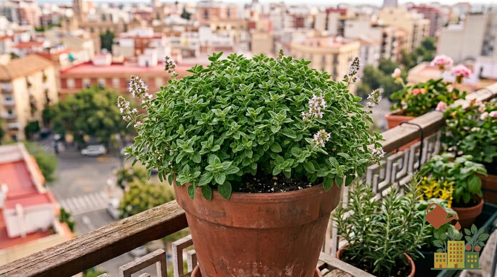

El orégano comparte casi todas las necesidades del romero y el tomillo (sol pleno, poca agua, sustrato drenante), pero tiene un comportamiento que sorprende a quien lo cultiva por primera vez: se extiende con bastante ganas, de forma parecida a la menta aunque menos agresiva.

<figure><figcaption>Orégano en maceta, resistente al sol y a la sequía</figcaption></figure>

*Este artículo contiene enlaces de afiliado. Si compras a través de ellos, podemos recibir una pequeña comisión sin coste adicional para ti.*

Si todavía no tienes semillas, aquí tienes semillas de orégano:

<a href="https://www.amazon.es/s?k=semillas+de+oregano&tag=mihuerto-herramientas-21" target="_blank" rel="sponsored noopener" class="btn-primary not-prose inline-block no-underline">Ver precio en Amazon</a>

## Maceta y sustrato

Igual que el resto de aromáticas mediterráneas, necesita un sustrato pobre y con buen drenaje. Mezcla [sustrato universal](/articulos/mejor-sustrato-huerto-urbano-maceta/) con un 30-40% de perlita o arena gruesa. Una maceta de 20-25 cm de diámetro es suficiente para empezar, aunque el orégano agradece algo de anchura si quieres que se extienda.

## Luz

Necesita sol directo la mayor parte del día para desarrollar todo su aroma. Con poca luz, crece más débil y con un sabor mucho más suave, casi insípido.

## Riego

Deja secar el sustrato casi por completo entre riego y riego, igual que con el romero y el tomillo. El exceso de riego es, con diferencia, el error más habitual y el que más rápido mata a esta aromática.

## Por qué menos agua da más sabor

Cuanto más "estresada" está la planta por sol y sequía moderada (dentro de lo razonable, sin llegar a marchitarse), más concentra los aceites esenciales responsables de su aroma. Un orégano regado en exceso o en semisombra crece más frondoso, pero con mucho menos sabor.

## Orégano, orégano griego o mejorana

Se confunden mucho en el vivero porque son parientes cercanos, pero no saben igual:

| Planta | Sabor | En maceta |
|---|---|---|
| Orégano común (*Origanum vulgare*) | Intenso, algo amargo | Muy resistente al frío y a la sequía |
| Orégano griego (*O. vulgare* subsp. *hirtum*) | El más aromático, el de pizza y ensaladas | Igual de fácil; búscalo si quieres sabor |
| Orégano dorado ('Aureum') | Suave | Más decorativo que culinario |
| Mejorana (*Origanum majorana*) | Más dulce y delicado | Más sensible al frío: protégela en invierno |

Si la etiqueta solo dice "orégano", frota una hoja: el griego tiene un olor mucho más fuerte y picante.

## Controla su tendencia a extenderse

El orégano se propaga por rizomas subterráneos y puede llegar a ocupar toda una maceta compartida en una temporada. Si lo cultivas junto a otras aromáticas, dale su propia maceta individual o revisa y recorta las raíces que invadan el espacio de las plantas vecinas cada cierto tiempo.

## Cuándo cosecharlo para secar

Para usarlo fresco, corta puntas cuando quieras. Para secarlo y guardarlo, el mejor momento es **cuando empiezan a abrirse las primeras flores**, a media mañana y con la planta seca: es cuando las hojas tienen más aceites esenciales. Corta los tallos dejando 8-10 cm sobre la tierra, átalos en ramilletes y cuélgalos boca abajo en un sitio seco y oscuro. Tienes el paso a paso en [cómo secar y conservar hierbas aromáticas](/articulos/como-secar-conservar-hierbas-aromaticas/).

## En invierno parece que se muere (y no)

El orégano común pierde gran parte de las hojas y tallos con el frío y se queda casi a ras de tierra. Es normal: las raíces siguen vivas y rebrota con fuerza en primavera. Corta los tallos secos, riega muy poco hasta que veas brotes nuevos y no lo tires.

## Poda

Poda después de la floración para mantener una forma compacta y estimular brotes nuevos. Recortar con regularidad también ayuda a controlar su expansión sin tener que replantar cada temporada.

## Problemas comunes

- **Sabor suave, poco aromático**: exceso de riego, sustrato demasiado rico, o falta de sol directo suficiente.
- **Planta que invade macetas vecinas**: normal en su forma de crecer; controla las raíces o dale una maceta propia.
- **Hojas amarillas o pudrición en la base**: casi siempre exceso de riego o mal drenaje del sustrato.

Si te interesa montar un pequeño rincón de aromáticas mediterráneas, consulta también nuestras guías de [cómo cultivar romero en balcón](/articulos/como-cultivar-romero-en-balcon/) y [cómo cultivar tomillo en maceta](/articulos/como-cultivar-tomillo-en-maceta/), con necesidades de cultivo muy parecidas.
