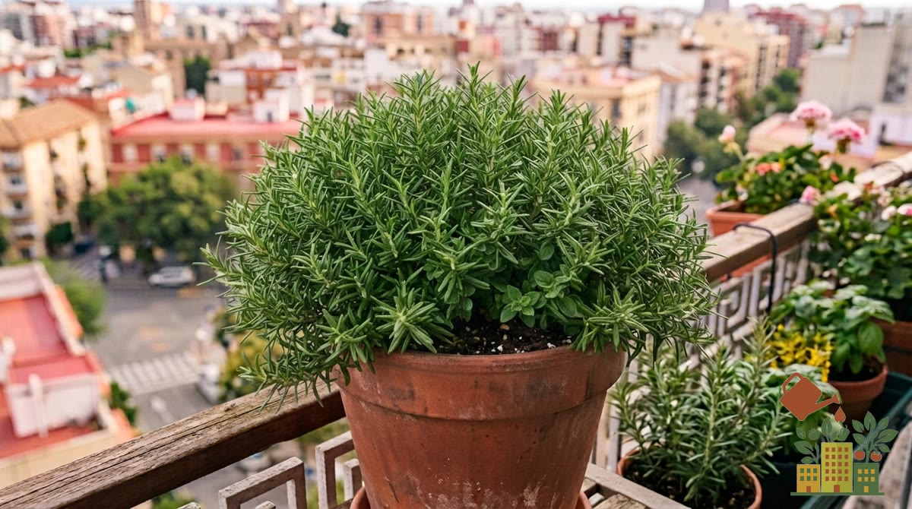

El romero es una de las aromáticas más agradecidas para un balcón: resiste bien la sequía puntual, apenas tiene plagas y, una vez establecido, requiere muy poco mantenimiento.

<figure><figcaption>Romero en maceta: casi imposible de matar, tolera sol y sequía</figcaption></figure>

*Este artículo contiene enlaces de afiliado. Si compras a través de ellos, podemos recibir una pequeña comisión sin coste adicional para ti.*

Si todavía no tienes semillas, aquí tienes semillas de romero:

<a href="https://www.amazon.es/s?k=semillas+de+romero&tag=mihuerto-herramientas-21" target="_blank" rel="sponsored noopener" class="btn-primary not-prose inline-block no-underline">Ver precio en Amazon</a>

## Maceta y sustrato

El romero necesita un sustrato con muy buen drenaje, ya que es una planta de origen mediterráneo poco tolerante al encharcamiento. Mezcla [sustrato universal](/articulos/mejor-sustrato-huerto-urbano-maceta/) con un 30-40% de perlita o arena gruesa. Una maceta de 25-30 cm es suficiente para una planta adulta.

## Luz

Necesita sol directo la mayor parte del día. Es una de las pocas aromáticas que agradece las ubicaciones más soleadas y calurosas del balcón, donde otras plantas sufrirían.

## Riego

Aquí está la clave para que el romero no muera: **riega poco y espaciado**. Deja que el sustrato se seque casi por completo entre riego y riego. El error más habitual con el romero no es la falta de agua, sino el exceso: las raíces se pudren mucho antes de que la planta sufra por sed.

## Erguido o rastrero: elige según tu balcón

| Tipo | Cómo crece | Dónde queda mejor |
|---|---|---|
| Romero erguido (el común) | Arbusto vertical de 60 cm a más de 1 m | Maceta honda en una esquina soleada |
| Romero rastrero o postrado | Ramas que caen, apenas sube 20-30 cm | Jardineras colgadas de la barandilla o bordes de muro |

Los dos tienen el mismo aroma y los mismos cuidados; el rastrero es ideal si tienes poco espacio en el suelo del balcón. Botánicamente hoy se llama *Salvia rosmarinus* (antes *Rosmarinus officinalis*), aunque en el vivero lo verás con los dos nombres.

## Poda: nunca cortes en madera vieja

Poda ligeramente después de la floración para mantener una forma compacta y estimular brotes nuevos, más tiernos y aromáticos que las ramas viejas y leñosas. La regla de oro del romero: **corta siempre por encima de una zona con hojas**. Si cortas una rama en la parte vieja, gris y sin hojas, lo normal es que no vuelva a brotar y la planta se quede con huecos.

## El romero a lo largo del año

| Época | Qué hacer |
|---|---|
| Invierno | Riego mínimo (cada 2-3 semanas en maceta, según lluvia y viento). En zonas de interior suele florecer a finales de invierno y es comida temprana para las abejas |
| Primavera | Poda suave tras la floración y mejor momento para esquejar |
| Verano | Aguanta el calor fuerte; riega cuando el sustrato esté seco del todo, sin dejar plato con agua |
| Otoño | Último recorte ligero y cosecha para secar antes del frío |

En el interior peninsular es una planta de casa: crece silvestre en el monte mediterráneo de Castilla-La Mancha y aguanta tanto las heladas como los 40 °C del verano mucho mejor que casi cualquier hortaliza.

## Cómo recolectar sin dañar la planta

Corta ramas enteras de unos 10-15 cm en lugar de arrancar hojas sueltas. El romero se seca muy bien colgado boca abajo en un lugar ventilado, y conserva su aroma durante meses.

## Multiplicar tu romero

Una de las ventajas del romero es que se reproduce fácilmente por esqueje: corta una rama semileñosa de 10 cm, retira las hojas de la mitad inferior y plántala directamente en sustrato húmedo. En pocas semanas debería enraizar.

## Problemas comunes

- **Hojas que se caen o amarillean**: casi siempre exceso de riego.
- **Planta que no crece**: falta de sol directo suficiente.
- **Se seca de repente, empezando por dentro**: casi siempre raíces podridas por exceso de agua, sobre todo en invierno con un plato debajo que acumula agua. Quita el plato, deja secar y riega mucho menos.
- **Manchas blancas polvorientas**: oídio, favorecido por poca ventilación; mejora la circulación de aire entre plantas.

Si te interesa montar un pequeño rincón de aromáticas, consulta también nuestra guía de [cómo cultivar albahaca en maceta sin que se seque](/articulos/como-cultivar-albahaca-en-maceta/), una combinación clásica junto al romero, o las de [tomillo](/articulos/como-cultivar-tomillo-en-maceta/) y [orégano](/articulos/como-cultivar-oregano-en-maceta/), que comparten prácticamente las mismas necesidades de riego y sol.
