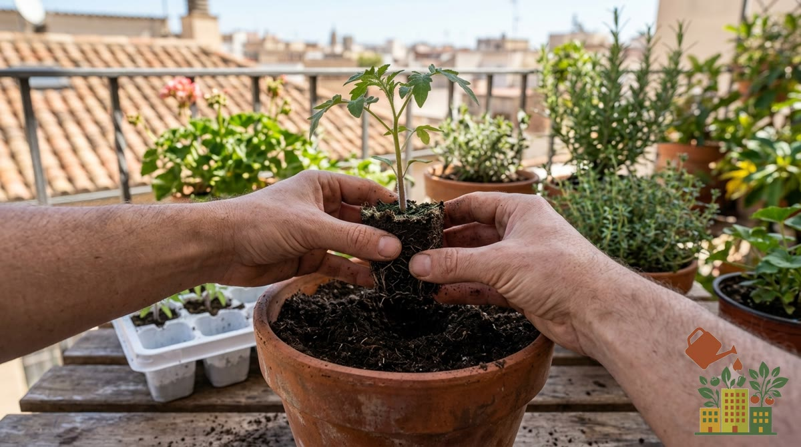

Montar un huerto urbano en el balcón no requiere jardín, ni grandes conocimientos de jardinería, ni una [inversión elevada](/articulos/cuanto-cuesta-montar-huerto-urbano-en-casa/). Si dudas entre balcón o huerto de suelo, aquí comparamos [huerto urbano frente a huerto tradicional](/articulos/huerto-urbano-vs-huerto-tradicional/). Con unas macetas, sustrato de calidad y un poco de sol, cualquier balcón o terraza puede convertirse en una pequeña despensa de hortalizas y aromáticas frescas.

*Este artículo contiene enlaces de afiliado. Si compras a través de ellos, podemos recibir una pequeña comisión sin coste adicional para ti.*

<figure><figcaption>El cepellón entero se pasa del alveolo a la maceta sin desmenuzar las raíces</figcaption></figure>

## 1. Evalúa cuánta luz recibe tu balcón

Antes de nada, mide bien la luz: te explicamos cómo en [cómo saber cuántas horas de sol tiene tu balcón](/articulos/cuantas-horas-sol-tiene-tu-balcon/).

Antes de comprar nada, observa tu balcón durante un día completo y anota cuántas horas de sol directo recibe:

- **6 horas o más de sol directo**: puedes cultivar prácticamente cualquier hortaliza (tomates, pimientos, calabacines).
- **3-5 horas de sol**: apuesta por lechugas, espinacas, rabanitos y aromáticas.
- **Menos de 3 horas / orientación norte**: opta por hojas verdes de sombra parcial y hierbas resistentes como la menta.

## 2. Elige las macetas adecuadas

El error más común al empezar es usar macetas demasiado pequeñas. Como norma general:

- Hortalizas de raíz profunda (tomate, pimiento, berenjena): mínimo 30-40 cm de profundidad.
- Hojas verdes y aromáticas: 15-20 cm de profundidad son suficientes.
- Prioriza macetas con buen drenaje y, si puedes, autorregantes: reducen muchísimo el riesgo de encharcamiento o sequía. Consulta nuestra comparativa de [mejores macetas autorregantes para balcón](/articulos/mejores-macetas-autorregantes-balcon-comparativa/) para ver precios según capacidad.

## 3. Elige un buen sustrato

No uses tierra de jardín normal: compacta demasiado en maceta. Un sustrato universal de calidad, aligerado con un 20-30% de perlita o fibra de coco, garantiza buen drenaje y aireación de raíces.

## 4. Empieza con cultivos "fáciles"

Para no frustrarte en tu primer intento, empieza con plantas agradecidas:

- Rabanitos (listos en 25-30 días)
- Lechugas de hoja
- Albahaca y perejil
- Judías verdes de mata baja

Deja los tomates, pimientos y berenjenas para cuando ya tengas algo de práctica con el riego y la luz. Si vas a cultivar [con niños](/articulos/huerto-balcon-con-ninos-que-plantar/), estos mismos cultivos rápidos son los que mejor funcionan por lo pronto que se ven resultados.

## 5. Organiza el riego desde el primer día

El riego irregular es la causa número uno de que un huerto de balcón fracase. Si vas a estar fuera de casa con frecuencia, considera desde el principio instalar un kit de riego por goteo con temporizador: te ahorrará disgustos y plantas muertas por olvido.

<a href="https://www.amazon.es/s?k=kit+riego+goteo+con+temporizador&tag=mihuerto-riego-21" target="_blank" rel="sponsored noopener" class="btn-primary not-prose inline-block no-underline">Ver precio en Amazon</a>

## 6. Ten paciencia con las primeras semanas

Las primeras 2-3 semanas tras la siembra o el trasplante son las más delicadas. Vigila que el sustrato no se seque completamente y protege las plántulas de vientos fuertes hasta que estén bien establecidas.

## Los errores que más se repiten

Casi todos los huertos de balcón que fracasan en las primeras semanas comparten los mismos fallos. Conocerlos de antemano te ahorrará disgustos:

- **Macetas demasiado pequeñas**: se secan en horas en verano y limitan las raíces. Comprueba el tamaño mínimo de cada cultivo: una lechuga necesita mucho menos que un tomate.
- **Regar todos los días "por si acaso"**: el exceso de agua ahoga las raíces y favorece hongos, y es más dañino que quedarse corto puntualmente. Mete un dedo 2-3 cm en el sustrato: si aún está húmedo, espera.
- **Elegir plantas por gusto y no por la luz**: un tomate en un balcón orientado al norte es la receta de la frustración. Mira primero tus horas de sol y elige después (si tu balcón tiene poca luz, aquí tienes [qué plantar en un balcón al norte o con sombra](/articulos/huerto-urbano-balcon-orientado-norte/)).
- **Macetas sin drenaje**: sin agujeros, o con el agujero tapado por el plato, el agua se acumula en la base y pudre las raíces.
- **Tierra de jardín en vez de sustrato**: se compacta y asfixia las raíces; mira qué buscar en la etiqueta en la guía del [mejor sustrato para maceta](/articulos/mejor-sustrato-huerto-urbano-maceta/).
- **No prever el riego en ausencias**: si vas a estar fuera más de 2-3 días, deja montado un riego sencillo antes de irte.
- **Ignorar los primeros síntomas de plagas**: pulgón, mosca blanca u hongos se controlan mucho mejor al principio. Revisa una vez por semana el envés de las hojas y consulta la [sección de plagas y enfermedades](/categorias/plagas-y-enfermedades/) si ves algo raro.

La mayoría de los fracasos no son por falta de "mano verde", sino por estos pequeños errores de base. Corrígelos desde el principio y aprenderás mucho más rápido.

## ¿Prefieres empezar con todo en un mismo pack?

Si no quieres comprar cada cosa por separado, existen [kits completos para principiantes](/articulos/mejores-kits-huerto-urbano-principiantes/) que incluyen macetas, sustrato y semillas en un mismo envío, pensados justo para dar este primer paso sin tener que acertar con cada compra por tu cuenta. Y si tu espacio es una terraza pequeña, repasa antes [qué necesitas para montar el huerto](/articulos/que-necesito-montar-huerto-terraza-pequena/).

## Siguientes pasos

Una vez tengas tu huerto en marcha, te recomendamos revisar nuestra comparativa de [mejor sistema de riego automático](/articulos/mejor-sistema-riego-automatico-macetas-balcon/) para automatizar el mantenimiento, y nuestro [calendario de siembra](../../categorias/calendario-de-siembra/) para saber qué plantar cada mes del año. Si prefieres adelantar la siembra antes de trasplantar a la maceta definitiva, consulta [cómo hacer un semillero casero paso a paso](/articulos/como-hacer-semillero-casero-paso-a-paso/).
