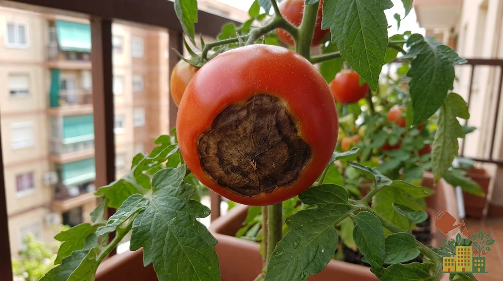
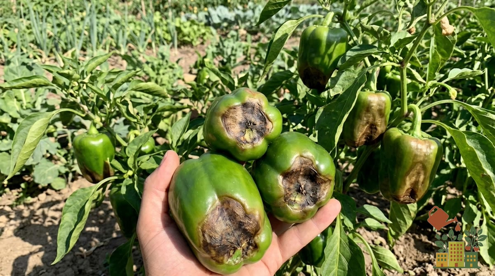

Ves un tomate o un pimiento que promete y, al girarlo, te encuentras una mancha oscura, hundida y correosa en la base. Es el temido **culo negro**, y la buena noticia es que casi siempre tiene fácil solución, porque no es ni un hongo ni una plaga.

<figure><figcaption>El culo negro se reconoce por la mancha seca y hundida en la base del tomate.</figcaption></figure>

## Qué es exactamente (y qué no es)

El culo negro, o **podredumbre apical**, es un **problema fisiológico**, no una enfermedad contagiosa. Aparece como una mancha marrón oscura, seca y hundida en la parte inferior del fruto (la opuesta al tallo). La causa de fondo es que **el calcio no llega bien al fruto** mientras engorda. Por eso no sirve de nada fumigar con fungicidas: el problema no está en un patógeno, sino en la nutrición y el agua de la planta.

Afecta **igual al tomate, al pimiento y a la berenjena**, con la misma mancha y la misma causa, así que todo lo que verás a continuación vale para los tres.

| | Tomate | Pimiento | Berenjena |
|---|---|---|---|
| Dónde sale la mancha | Base del fruto | Punta del fruto | Punta del fruto |
| Aspecto | Marrón oscuro, plano o hundido, como cuero | Marrón claro a oscuro, seco y hundido | Marrón, hundido |
| Frutos más afectados | Variedades alargadas (pera, roma) y los primeros de la temporada | Los primeros frutos y los de variedades grandes | Los primeros frutos |

En los tres casos la solución es la misma: riego constante, acolchado y poco nitrógeno.

## Cómo se ve en el pimiento

En el pimiento la mancha aparece en la **punta** (la parte de abajo del fruto) y suele empezar como una zona acuosa que en pocos días se seca, se hunde y se vuelve marrón. A veces se confunde con una quemadura de sol, pero la quemadura sale en el lado que da al sol, no en la punta, y tiene un tono más blanquecino.

<figure><figcaption>En el pimiento, la mancha seca y hundida aparece en la punta del fruto.</figcaption></figure>

## La causa principal en maceta: el riego irregular

Aunque se habla mucho de "falta de calcio", en un balcón el detonante casi siempre es el **riego desigual**. La mayoría de las veces hay calcio de sobra en la tierra: el problema es que la planta no consigue transportarlo hasta el fruto. El calcio viaja con el agua, así que si la planta pasa de la sequía al encharcamiento una y otra vez, el reparto se corta y aparece la mancha.

Las macetas son especialmente propensas porque se secan rápido y los altibajos de humedad son mayores que en el suelo. Los días de mucho calor y viento, típicos del verano en el interior peninsular, la planta transpira tanto que el poco calcio que sube se va a las hojas y no al fruto. Repasa tus pautas en [cuánta agua necesitan las plantas del huerto](/articulos/cuanta-agua-necesitan-plantas-huerto-balcon/).

## El mito de la leche (y el de las cáscaras de huevo)

Es muy habitual oír que se cura **fumigando con leche mezclada con agua** o enterrando **cáscaras de huevo** junto a la planta. Ninguno de los dos funciona a tiempo:

- La leche no cambia **cómo la planta reparte el agua y el calcio por dentro**, que es donde está el problema.
- Las cáscaras de huevo tardan muchos meses en descomponerse y, además, el calcio casi nunca falta en la tierra.

## Cómo solucionarlo paso a paso

1. **Regulariza el riego.** Es lo más importante. Riega de forma constante, sin dejar que el sustrato se seque del todo entre riegos ni encharcarlo. Un [sistema de riego automático](/articulos/mejor-sistema-riego-automatico-macetas-balcon/) resuelve esto casi por completo.
2. **Pon un acolchado** sobre la tierra (paja, fibra de coco, hierba seca): conserva la humedad y suaviza los cambios.
3. **No te pases con el nitrógeno.** Un exceso de abono nitrogenado dispara el crecimiento y agrava el problema. Usa un [fertilizante equilibrado](/articulos/mejores-fertilizantes-organicos-huerto-maceta/) pensado para fructificación.
4. **Retira los frutos ya afectados** para que la planta concentre su energía en los sanos.

## Otros factores que ayudan

- **Maceta grande**: cuanto más volumen de sustrato, más estable es la humedad. Para tomate o pimiento, mínimo 30-40 litros; en maceta pequeña el problema es mucho más frecuente.
- **Sustrato de calidad**: uno pobre o compactado dificulta la absorción. Consulta [el mejor sustrato para huerto en maceta](/articulos/mejor-sustrato-huerto-urbano-maceta/).
- **Paciencia**: los primeros frutos de la temporada son los más propensos; a medida que la planta se estabiliza, el problema suele desaparecer.

## Ojo: no lo confundas con otros problemas

- Si la mancha está en un **lateral** del fruto y no en la base, o ves podredumbre blanda con moho, probablemente sea otra cosa: un golpe, una quemadura de sol o un hongo.
- Si en el tomate ves **cicatrices, agujeros y tejido corchoso** deformando el culo, no es culo negro sino [cara de gato](/articulos/cara-de-gato-tomate-deformado-cicatrices/), una malformación por frío en la floración.
- Si las hojas amarillean, repasa [por qué se ponen amarillas las tomateras](/articulos/por-que-tomateras-se-ponen-amarillas/) o [las hojas amarillas del pimiento](/articulos/hojas-amarillas-pimiento-causas-solucion/).
- En el pimiento, si lo que se te caen son las flores antes de cuajar, mira [por qué se caen las flores del pimiento](/articulos/flores-pimiento-se-caen-sin-cuajar/); y si la planta está frondosa pero no da frutos, [pimiento con mucha mata y pocos frutos](/articulos/pimiento-mucha-mata-pocos-frutos/).

Con un riego constante, es de los problemas más fáciles de corregir en el huerto de balcón. Para el cultivo completo, consulta [cómo cultivar tomates en maceta](/articulos/como-cultivar-tomates-en-maceta-balcon/) y [cómo cultivar pimientos en maceta](/articulos/como-cultivar-pimientos-en-maceta/).
