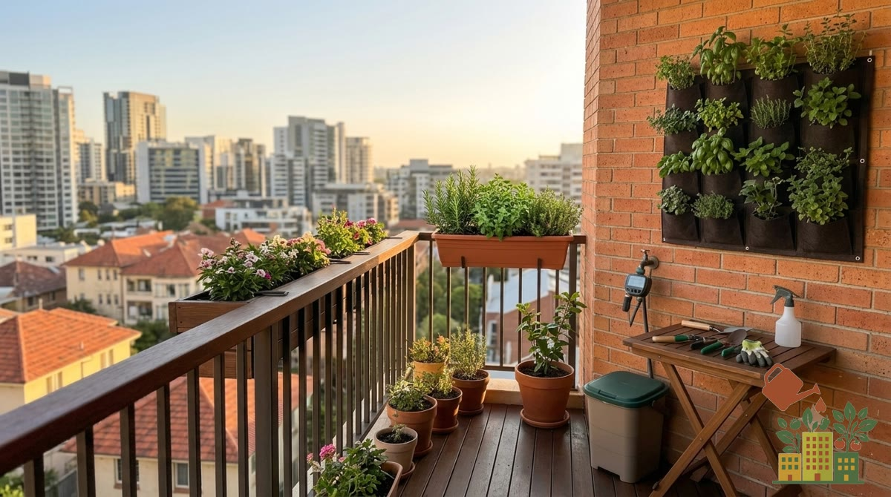

Las aromáticas son la mejor puerta de entrada al huerto de balcón: ocupan poco, se usan a diario en la cocina y la mayoría son muy fáciles. Esta guía reúne todo lo que necesitas para montar tu propio jardín de hierbas, con enlace a la ficha completa de cada una.

<figure><figcaption>Con unas pocas macetas de aromáticas tienes hierbas frescas para cocinar todo el año</figcaption></figure>

*Este artículo contiene enlaces de afiliado. Si compras a través de ellos, podemos recibir una pequeña comisión sin coste adicional para ti.*

Si vas a juntar varias aromáticas, una jardinera alargada para la barandilla o el suelo te ahorra espacio:

<a href="https://www.amazon.es/s?k=jardinera+balcon+rectangular&tag=mihuerto-herramientas-21" target="_blank" rel="sponsored noopener" class="btn-primary not-prose inline-block no-underline">Ver jardineras en Amazon</a>

## Las 5 más fáciles para empezar

Si es tu primera vez, estas son las que mejor perdonan riegos irregulares o falta de experiencia:

1. **[Romero](/articulos/como-cultivar-romero-en-balcon/)**: tolera la sequía ocasional y el sol intenso, y apenas necesita cuidados una vez establecido. Si solo vas a empezar con una, que sea esta.
2. **[Menta](/articulos/como-cultivar-menta-en-maceta/)**: facilísima de mantener viva; lo único que pide es ir en maceta individual para que no invada a las demás.
3. **[Albahaca](/articulos/como-cultivar-albahaca-en-maceta/)**: muy agradecida y de las más usadas en cocina, aunque algo más exigente con el riego que el romero.
4. **[Orégano](/articulos/como-cultivar-oregano-en-maceta/)**: tan resistente como el romero al sol y la sequía, y se seca fácilmente para conservarlo durante meses.
5. **[Perejil](/articulos/como-cultivar-perejil-en-maceta/)**: algo más exigente en riego, pero de crecimiento fiable y rápido, y tolera la semisombra.

Si prefieres arrancar varias de golpe, un kit de semillas de aromáticas es la forma más barata de empezar:

<a href="https://www.amazon.es/s?k=kit+semillas+aromaticas&tag=mihuerto-herramientas-21" target="_blank" rel="sponsored noopener" class="btn-primary not-prose inline-block no-underline">Ver kits de semillas de aromáticas en Amazon</a>

## Primero: agrupa según necesidades

El secreto para que convivan bien es **juntar las que quieren lo mismo**. Se dividen en dos grandes grupos:

- **Mediterráneas (sol pleno, poca agua)**: romero, tomillo, orégano, salvia, laurel. Casi indestructibles.
- **De más agua y algo de sombra**: perejil, cilantro, cebollino, menta, albahaca.

Mezclar una de cada grupo en la misma maceta es el error más común: una de las dos siempre sufre.

## Las aromáticas mediterráneas (para balcón soleado)

Quieren **sol y sequedad**, y perdonan el olvido de riego. Perfectas si tu balcón da al sur:

- **[Romero](/articulos/como-cultivar-romero-en-balcon/)**: casi imposible de matar, perenne y aromático todo el año.
- **[Tomillo](/articulos/como-cultivar-tomillo-en-maceta/)**: resiste sol y sequía, ideal en jardinera.
- **[Orégano](/articulos/como-cultivar-oregano-en-maceta/)**: muy resistente y fácil de secar para conservar.
- **[Salvia](/articulos/como-cultivar-salvia-en-maceta/)**: de hoja aterciopelada, pódala para que no se haga leñosa.
- **[Laurel](/articulos/como-cultivar-laurel-en-maceta/)**: un arbusto longevo que te da hoja durante años.

Puedes juntarlas todas en una misma jardinera soleada.

## Las de más agua y algo de sombra

Toleran bien la **media sombra**, así que son la solución para balcones que no reciben sol directo todo el día:

- **[Perejil](/articulos/como-cultivar-perejil-en-maceta/)**: básico de cocina, tolera bien la semisombra.
- **[Cilantro](/articulos/como-cultivar-cilantro-en-maceta/)**: rápido, pero con calor florece y pierde sabor.
- **[Cebollino](/articulos/como-cultivar-cebollino-en-maceta/)**: se corta y rebrota una y otra vez.
- **[Menta](/articulos/como-cultivar-menta-en-maceta/)**: siempre en maceta individual, porque es invasiva.
- **[Albahaca](/articulos/como-cultivar-albahaca-en-maceta/)**: de calor; pinza las flores para que siga dando hoja.

## Otras aromáticas para dar el salto

Cuando le cojas el gusto, amplía la colección con estas dos, muy agradecidas en maceta soleada:

- **[Eneldo](/articulos/como-cultivar-eneldo-en-maceta/)**: de sabor fresco para pescados y encurtidos, crece rápido desde semilla y atrae insectos beneficiosos.
- **[Manzanilla](/articulos/como-cultivar-manzanilla-en-maceta/)**: sus florecitas se secan para infusiones caseras; resiste el sol y la sequía como las mediterráneas.

## Riego y cuidados generales

- **Mediterráneas**: riega solo cuando el sustrato esté seco; el exceso de agua las pudre.
- **Del segundo grupo**: mantén el sustrato algo húmedo, sin encharcar.
- **Sustrato**: suelto y bien drenante para todas; mira [el mejor sustrato](/articulos/mejor-sustrato-huerto-urbano-maceta/).
- **Poda y pinzado**: corta las puntas a menudo para que ramifiquen y no florezcan antes de tiempo.

## Cosecha y conservación

Ve **cortando a demanda**, siempre menos de un tercio de la planta cada vez. Cuando tengas excedente (típico de las mediterráneas en verano), consérvalo: te lo explicamos en [cómo secar y conservar hierbas aromáticas](/articulos/como-secar-conservar-hierbas-aromaticas/).

## Por dónde empezar

Si es tu primera vez, arranca con las [5 más fáciles](#las-5-más-fáciles-para-empezar) y monta un [huerto de aromáticas en la cocina o en interior](/articulos/huerto-aromaticas-interior-poca-luz/), incluso con poca luz. Para saber cuál te va según tu balcón, usa la [calculadora de qué plantar](/que-plantar-en-tu-balcon/).

Con tres o cuatro macetas bien elegidas tendrás hierbas frescas para cocinar durante todo el año, con muy poco trabajo. Las aromáticas son, sin duda, el mejor primer paso en el huerto de balcón.
