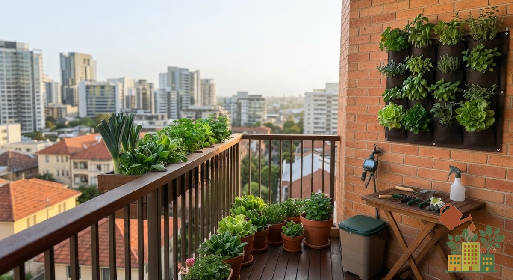

Un balcón orientado al norte, o uno que queda a la sombra de edificios vecinos, recibe muy poca luz solar directa, y eso condiciona bastante qué se puede cultivar con éxito. No significa que no puedas tener huerto, pero sí que hay que elegir bien. No todos los balcones reciben las 6 horas de sol directo que necesitan tomates o pimientos; con menos luz (2-4 horas directas, o luz indirecta constante) sigue siendo posible cultivar si eliges las especies adecuadas.

<figure><figcaption>Con luz de sombra, los cultivos de hoja (lechugas, espinacas, aromáticas) son los que mejor rinden</figcaption></figure>

## Cuánta luz recibe realmente un balcón norte

En el hemisferio norte, una orientación norte apenas recibe sol directo salvo quizás algunos minutos a primera o última hora en pleno verano. La mayor parte del tiempo, la luz disponible es indirecta y de intensidad moderada-baja. Si no lo tienes claro, mide tu caso con [cómo saber cuántas horas de sol tiene tu balcón](/articulos/cuantas-horas-sol-tiene-tu-balcon/).

## Por qué la sombra no significa "nada de cultivo"

Muchas hortalizas de hoja toleran perfectamente 3-4 horas de sol directo, o luz indirecta brillante durante gran parte del día, sin sacrificar demasiado su producción. Crecen algo más despacio que a pleno sol, pero cumplen.

## Qué sí puedes cultivar

- **Lechugas y hojas de ensalada**: de las hortalizas más tolerantes a la falta de sol directo; además, en verano el sol intenso puede perjudicarlas, así que la sombra parcial llega a ser una ventaja. Consulta [cómo cultivar lechugas en huerto urbano](/articulos/como-cultivar-lechugas-huerto-urbano/).
- **Espinacas**: rinden bien con luz moderada; tienes los detalles en [cómo cultivar espinacas en maceta](/articulos/como-cultivar-espinacas-en-maceta/).
- **[Acelgas](/articulos/como-cultivar-acelgas-en-maceta/)**: de las hortalizas de hoja más resistentes a la poca luz.
- **Rabanitos**: toleran bien la semisombra manteniendo un ciclo de cultivo razonablemente rápido.
- **Menta y [perejil](/articulos/como-cultivar-perejil-en-maceta/)**: entre las aromáticas, las que mejor toleran la semisombra constante sin perder demasiado vigor.
- **Helechos y plantas ornamentales de sombra**: si no buscas producción comestible, hay muchas opciones decorativas pensadas específicamente para poca luz.

## Qué evitar

Tomates, pimientos, berenjenas, calabacines y la mayoría de frutales necesitan sol directo abundante para producir fruto. En sombra crecerán en tamaño de planta, pero darán muy poco o ningún fruto aprovechable por mucho cuidado que les dediques.

## Cómo maximizar la poca luz disponible

- Usa superficies claras (macetas, paredes de fondo) que reflejen algo más de luz ambiental hacia las plantas.
- Coloca las plantas lo más cerca posible de la barandilla o el borde del balcón, donde suele llegar algo más de luz indirecta que junto a la pared del fondo.
- Si tienes zonas con distinta exposición en el mismo balcón, reserva la más soleada para lo que más luz pida y deja la de sombra para hojas verdes y aromáticas tolerantes.
- Fíjate en si la sombra es de un edificio vecino que cambia con la estación: algunos balcones reciben más sol en verano (con el sol más alto) que en invierno.
- Considera una [luz de cultivo LED](/articulos/mejores-luces-led-cultivo-interior/) complementaria si quieres ampliar las opciones más allá de las tolerantes a sombra.

## Ajusta también el riego

Con menos luz y menos calor, la evaporación es más lenta, así que las plantas en un balcón norte necesitan riegos menos frecuentes que las de un balcón muy soleado. Revisa el sustrato antes de regar para no excederte, ya que el exceso de humedad es un riesgo mayor en estas condiciones de poca luz y evaporación lenta.
