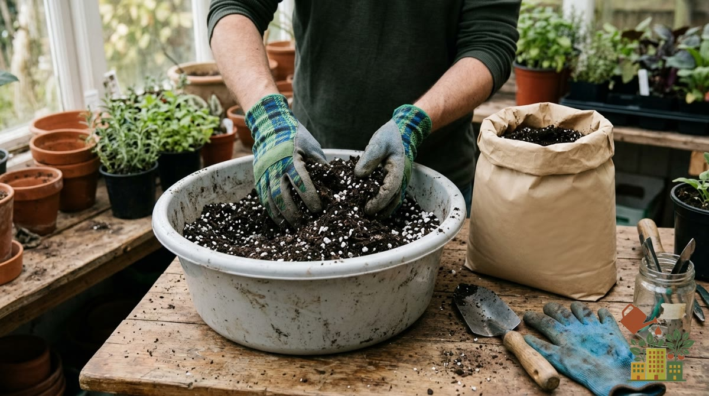

Elegir un buen sustrato es una de las decisiones que más impacto tiene en el éxito de un huerto urbano, y sin embargo se le presta mucha menos atención que a las macetas o el riego. Aquí tienes los tipos que merecen la pena según lo que vayas a cultivar, qué mirar en la etiqueta antes de comprar y cuántos litros vas a necesitar.

## Resumen rápido: qué sustrato para cada cultivo

| Cultivo | Sustrato | pH aproximado | Extra recomendado |
|---|---|---|---|
| Lechugas, espinacas, acelgas | Universal de calidad | 6-7 | 20 % de perlita |
| Tomates, pimientos, berenjenas | Específico para hortalizas | 6-6,8 | Abono de base y compost |
| Aromáticas mediterráneas (romero, tomillo, orégano) | Universal | 6,5-7,5 | 30-40 % de perlita o arena gruesa |
| Limonero y otros cítricos | Específico para cítricos | 6-6,5 | Buen drenaje en el fondo |
| Arándanos | Para acidófilas | 4,5-5,5 | Riego con agua poco calcárea |
| Semilleros | Específico para semilleros | 5,5-6,5 | Textura fina, sin abono fuerte |

*Este artículo contiene enlaces de afiliado. Si compras a través de ellos, podemos recibir una pequeña comisión sin coste adicional para ti.*

<figure><figcaption>Mezclar el sustrato con perlita mejora la aireación y el drenaje en maceta</figcaption></figure>

## Por qué no sirve la tierra de jardín

La tierra de jardín normal se compacta en una maceta, reteniendo mal el agua y el aire. Un sustrato para maceta está formulado específicamente para mantener una buena aireación y drenaje en un volumen reducido.

## 1. Sustrato universal de calidad

La opción más versátil y recomendable para empezar. Un buen sustrato universal, aligerado con perlita, sirve para la mayoría de aromáticas y hortalizas de hoja.

**Recomendado para**: principiantes, aromáticas, hortalizas de hoja.

<a href="https://www.amazon.es/s?k=sustrato+universal+con+perlita&tag=mihuerto-herramientas-21" target="_blank" rel="sponsored noopener" class="btn-primary not-prose inline-block no-underline">Ver precio en Amazon</a>

## 2. Sustrato específico para hortalizas

Formulado con más materia orgánica y nutrientes de base, pensado para cultivos más exigentes como el tomate o el pimiento, que agotan antes los nutrientes del sustrato.

**Recomendado para**: tomates, pimientos, berenjenas y otras hortalizas de fruto.

<a href="https://www.amazon.es/s?k=sustrato+para+hortalizas+y+tomates&tag=mihuerto-herramientas-21" target="_blank" rel="sponsored noopener" class="btn-primary not-prose inline-block no-underline">Ver precio en Amazon</a>

## 3. Sustrato para cítricos y frutales

Con un pH ligeramente más ácido y mayor proporción de materia orgánica de liberación lenta, pensado para las necesidades específicas de limoneros, naranjos y otros frutales de maceta.

**Recomendado para**: frutales en maceta como el limonero.

<a href="https://www.amazon.es/s?k=sustrato+para+citricos+y+frutales&tag=mihuerto-herramientas-21" target="_blank" rel="sponsored noopener" class="btn-primary not-prose inline-block no-underline">Ver precio en Amazon</a>

## 4. Sustrato para plantas acidófilas

Necesario para cultivos como el arándano, que requieren un pH bajo que la mayoría de sustratos universales no ofrecen.

**Recomendado para**: arándanos y otras plantas de suelo ácido.

<a href="https://www.amazon.es/s?k=sustrato+plantas+acidofilas+arandanos&tag=mihuerto-herramientas-21" target="_blank" rel="sponsored noopener" class="btn-primary not-prose inline-block no-underline">Ver precio en Amazon</a>

## 5. Mezclas caseras con perlita o fibra de coco

Muchos huertos urbanos avanzados mezclan su propio sustrato: sustrato universal + un 20-30% de perlita (para aireación) + un 10-20% de fibra de coco (para retener humedad de forma más equilibrada que la turba sola). Te explicamos las proporciones paso a paso en [cómo hacer sustrato casero para macetas](/articulos/como-hacer-sustrato-casero-macetas/).

**Recomendado para**: quien ya tiene experiencia y quiere ajustar la mezcla a cada cultivo.

<a href="https://www.amazon.es/s?k=perlita+y+fibra+de+coco+para+sustrato&tag=mihuerto-herramientas-21" target="_blank" rel="sponsored noopener" class="btn-primary not-prose inline-block no-underline">Ver precio en Amazon</a>

## Qué mirar en la etiqueta

- **Composición**: busca una mezcla con turba o fibra de coco (retención de humedad) combinada con perlita o vermiculita (aireación y drenaje).
- **pH indicado**: la mayoría de hortalizas prefieren un pH neutro a ligeramente ácido (6-7). Compruébalo sobre todo si vas a cultivar especies con necesidades especiales, como los arándanos.
- **Abono de base**: muchos sustratos ya incluyen un abono de liberación lenta para las primeras semanas, así que no hace falta abonar nada más trasplantar.
- **Conductividad (CE)**: algunas marcas la indican. Para semilleros y plantas jóvenes, mejor valores bajos; un sustrato muy cargado de sales puede quemar las raíces finas.

## Cuántos litros necesitas

El volumen de la maceta es, prácticamente, el sustrato que tienes que comprar. Como referencia:

| Maceta | Litros aproximados | Para qué |
|---|---|---|
| 20 cm de diámetro | 4-5 L | Aromáticas, rabanitos, una lechuga |
| 30 cm de diámetro | 12-15 L | Acelgas, espinacas, fresas |
| 40 cm de diámetro | 30-35 L | Tomate, pimiento, berenjena |
| Jardinera de 80 × 20 cm | 25-30 L | Lechugas en hilera, ajos, cebollas |
| Saco de cultivo de 50 L | 50 L | Patatas, calabacín |

Suma las macetas que vas a llenar antes de ir a la tienda: los sacos suelen venir de 20, 50 u 80 litros y el grande casi siempre sale más barato por litro. Si dudas del tamaño de maceta, mira nuestra [guía de tamaño de maceta para cada hortaliza](/articulos/tamano-maceta-cada-hortaliza-guia/).

## Errores comunes al comprar

- **Elegir por precio sin mirar la composición**: los sustratos más baratos suelen llevar menos materiales de aireación y se compactan antes.
- **Un único saco genérico para cultivos muy distintos**: un arándano y un tomate necesitan un pH muy diferente.
- **Comprar "tierra vegetal" o "tierra de jardín"**: está pensada para enmendar parterres, no para macetas.
- **No renovar el sustrato**: incluso el mejor se agota; abajo te explicamos cuándo hacerlo.

## Cómo elegir si solo vas a comprar un tipo

Si vas a tener un único saco de sustrato para todo el huerto, el sustrato universal de calidad aligerado con perlita es la opción más segura: cubre bien la mayoría de cultivos comunes de balcón, aunque no sea el óptimo específico para cada uno.

## Cuándo renovar el sustrato

El sustrato se agota de nutrientes con el tiempo, incluso abonando. Como norma general, renueva o refresca (mezclando con sustrato nuevo) el de cada maceta una vez al año, coincidiendo con el inicio de la temporada de siembra en primavera.

Si además quieres reducir costes y aprovechar tus propios restos orgánicos, revisa nuestra guía de [cómo hacer compost casero en un piso sin jardín](/articulos/como-hacer-compost-casero-piso-sin-jardin/) para enriquecer tu propio sustrato.
