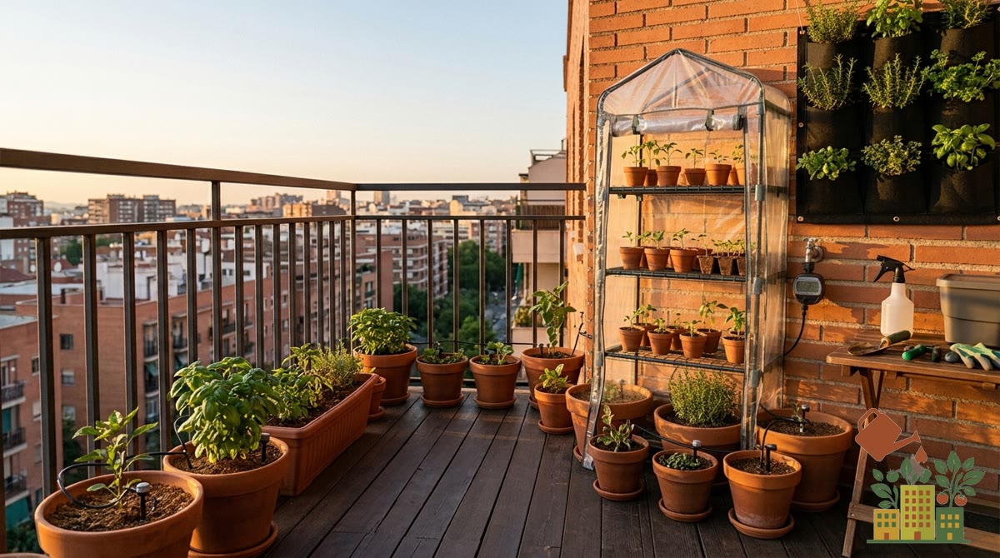

En invierno, una helada puede echar a perder en una noche los cultivos que llevas meses cuidando. En maceta el frío pega más, porque las raíces quedan más expuestas que en el suelo. Con la protección adecuada, tu huerto de balcón supera el invierno sin bajas.

<figure><figcaption>Un mini-invernadero o un velo antiheladas protegen los cultivos en las noches de hielo</figcaption></figure>

*Este artículo contiene enlaces de afiliado. Si compras a través de ellos, podemos recibir una pequeña comisión sin coste adicional para ti.*

## 1. Velo o malla antiheladas

Una tela blanca ligera y translúcida que colocas sobre las plantas. **Retiene calor y sube unos grados** la temperatura debajo, dejando pasar luz, aire y agua. Se puede dejar puesta varios días seguidos y es la protección más versátil y barata.

**Recomendada para**: cubrir cultivos de hoja y hortalizas en las noches frías.

### ¿Qué gramaje elegir?

El velo se vende por su peso en gramos por metro cuadrado: cuanto más pesa, más abriga, pero menos luz deja pasar. Estas son las cifras de la tabla del fabricante Agribon, uno de los más usados en horticultura:

| Gramaje | Luz que deja pasar | Protección aproximada | En el balcón |
|---|---|---|---|
| ~19 g/m² (fino) | 85 % | 1-2 °C | Se puede dejar puesto días seguidos sobre hojas y semilleros |
| ~30 g/m² (medio) | 70 % | 2-3 °C | Buen término medio para noches de helada suave |
| ~50 g/m² (grueso) | 50 % | 3-4 °C | Solo en olas de frío; quítalo después para que la planta tenga luz |

*La protección real depende de cómo lo pongas (que llegue hasta la maceta, sin huecos) y del viento. Datos en grados Fahrenheit en el original, convertidos a Celsius y redondeados.*

<a href="https://www.amazon.es/s?k=velo+antiheladas+plantas&tag=mihuerto-herramientas-21" target="_blank" rel="sponsored noopener" class="btn-primary not-prose inline-block no-underline">Ver precio en Amazon</a>

## 2. Fundas protectoras para plantas

Sacos o fundas de tejido antiheladas con cordón, pensados para envolver una planta concreta (un frutal, un arbusto). Cómodas de poner y quitar y reutilizables cada invierno.

**Recomendadas para**: proteger frutales en maceta o plantas grandes individuales.

<a href="https://www.amazon.es/s?k=funda+proteccion+plantas+invierno&tag=mihuerto-herramientas-21" target="_blank" rel="sponsored noopener" class="btn-primary not-prose inline-block no-underline">Ver precio en Amazon</a>

## 3. Mini-invernadero de balcón

Una estructura con estantes y funda transparente que crea un microclima más cálido y protegido. Ideal para resguardar varias macetas a la vez y para adelantar semilleros. Tienes el detalle en [mini-invernaderos de balcón](/articulos/mini-invernadero-balcon-mejores-opciones/).

**Recomendado para**: proteger varias plantas juntas y criar semilleros en frío.

<a href="https://www.amazon.es/s?k=mini+invernadero+balcon&tag=mihuerto-herramientas-21" target="_blank" rel="sponsored noopener" class="btn-primary not-prose inline-block no-underline">Ver precio en Amazon</a>

## 4. Protección de las macetas (plástico de burbujas / arpillera)

Para proteger las **raíces**, que en maceta sufren más: envuelve el recipiente con plástico de burbujas o arpillera. Se combina con cualquiera de las opciones anteriores para proteger planta y raíz a la vez.

**Recomendada para**: reforzar la protección de la raíz en heladas fuertes.

<a href="https://www.amazon.es/s?k=arpillera+yute+proteccion+macetas&tag=mihuerto-herramientas-21" target="_blank" rel="sponsored noopener" class="btn-primary not-prose inline-block no-underline">Ver precio en Amazon</a>

## Cómo ponerlo en una maceta

1. **Ponlo por la tarde**, antes de que caiga el sol, para atrapar el calor que ha acumulado la tierra durante el día.
2. **Que no aplaste la planta**: clava tres o cuatro cañas o un arco de alambre en la maceta y apoya el velo encima. Así no toca las hojas, que es por donde más frío pasa.
3. **Bájalo hasta la maceta** y sujétalo con una goma, una cuerda o pinzas de tender. Si queda abierto por abajo, el aire frío entra y protege mucho menos.
4. **Junta las macetas** contra la pared antes de cubrirlas: con un solo trozo de velo tapas varias y se abrigan entre ellas.
5. **Quítalo o ábrelo los días templados y de sol** si es grueso, para que la planta reciba luz y no se acumule humedad. El velo fino puede quedarse puesto.

Para el resto de medidas (riego, qué plantas aguantan y qué hacer después de una helada), mira la guía de [cómo proteger el huerto del frío y las heladas](/articulos/proteger-huerto-frio-heladas-balcon/).

## Nuestra recomendación

- **Solución general y barata**: opción 1 (velo antiheladas).
- **Un frutal o planta grande**: opción 2 (funda).
- **Varias macetas o semilleros**: opción 3 (mini-invernadero).
- **Heladas fuertes**: suma la opción 4 para la raíz.

Recuerda: el velo antiheladas es de **invierno** y no debe confundirse con la [malla de sombreo](/articulos/mejores-mallas-sombreo-proteccion-solar-huerto/), que es de verano. Para saber qué cultivos aguantan el frío a la intemperie, consulta [qué plantar en el balcón en invierno sin que se hiele](/articulos/que-plantar-balcon-invierno-sin-helar/).

## Fuentes

- Johnny's Selected Seeds, [tabla comparativa de mantas de cultivo Agribon](https://www.johnnyseeds.com/on/demandware.static/-/Library-Sites-JSSSharedLibrary/default/dw02981d54/assets/information/row-covers-comparison-chart.pdf) (gramaje, luz y protección frente a heladas).
