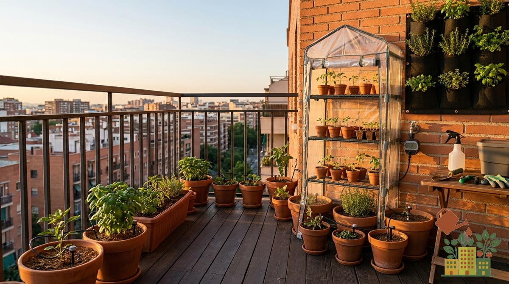

Un mini invernadero de balcón permite adelantar la siembra de primavera y proteger plantas sensibles durante los meses más fríos, sin necesitar el espacio de un invernadero de jardín tradicional.

*Este artículo contiene enlaces de afiliado. Si compras a través de ellos, podemos recibir una pequeña comisión sin coste adicional para ti.*

<figure><figcaption>Invernadero de estantería con cubierta de PVC: protege varias baldas de macetas a la vez</figcaption></figure>

## 1. Mini invernadero de sobremesa para semilleros

Una bandeja de semillero con tapa de plástico transparente, del tamaño justo para varias docenas de alveolos. La opción más pequeña y económica, pensada exclusivamente para la fase de germinación.

**Recomendado para**: adelantar la siembra de primavera desde el interior de la vivienda.

<a href="https://www.amazon.es/s?k=mini+invernadero+semillero+sobremesa&tag=mihuerto-herramientas-21" target="_blank" rel="sponsored noopener" class="btn-primary not-prose inline-block no-underline">Ver precio en Amazon</a>

## 2. Invernadero de estantería con cubierta de PVC

Una estructura con varias baldas y una cubierta de PVC con cremallera que permite abrir para acceder a las plantas. Ofrece mucho más espacio que el mini invernadero de sobremesa, permitiendo albergar varias macetas ya crecidas, no solo semilleros.

**Recomendado para**: proteger un grupo de macetas completo durante el invierno, o adelantar el cultivo de plantas ya trasplantadas.

<a href="https://www.amazon.es/s?k=invernadero+estanteria+cubierta+pvc+balcon&tag=mihuerto-herramientas-21" target="_blank" rel="sponsored noopener" class="btn-primary not-prose inline-block no-underline">Ver precio en Amazon</a>

## 3. Fundas o campanas individuales para maceta

Cubren una única maceta o planta de forma independiente, útiles para proteger puntualmente un cultivo sensible sin necesidad de montar una estructura para todo el huerto.

**Recomendadas para**: proteger de forma puntual una o dos plantas concretas (por ejemplo, un limonero joven) frente a una helada anunciada.

<a href="https://www.amazon.es/s?k=funda+campana+proteccion+helada+maceta&tag=mihuerto-herramientas-21" target="_blank" rel="sponsored noopener" class="btn-primary not-prose inline-block no-underline">Ver precio en Amazon</a>

## Cómo elegir según tu necesidad

- **Solo quieres adelantar la siembra de semillas**: opción 1 (sobremesa).
- **Quieres proteger varias macetas ya crecidas durante el invierno**: opción 2 (estantería con PVC).
- **Solo necesitas proteger una o dos plantas puntuales**: opción 3 (fundas individuales).

## Cuándo merece la pena en un clima de interior

Un mini invernadero no "calienta" por la noche: retiene el calor que acumuló de día y gana unos pocos grados frente al exterior, más si está pegado a una pared que da al sur. Contra una helada ligera eso suele bastar; contra una ola de frío fuerte, no del todo, y conviene añadir una manta térmica por encima.

Con datos de AEMET para Toledo, el uso tiene sentido sobre todo en estos meses:

| Mes | Días de helada de media | Para qué usarlo |
|---|---|---|
| Noviembre | 3,3 | Alargar las lechugas y proteger plantas recién trasplantadas |
| Diciembre | 9,8 | Proteger hojas de invierno y plántulas |
| Enero | 12,7 | El mes más frío: semilleros y plantas delicadas |
| Febrero | 6,9 | Empezar los semilleros de tomate, pimiento y berenjena |
| Marzo | 2,3 | Endurecer plántulas antes de sacarlas (ver [cómo endurecer plántulas](/articulos/endurecer-plantulas-antes-trasplantar/)) |

En el interior también hay que vigilar el otro extremo: un día soleado de marzo o abril, con máximas medias de 18-20 °C, puede disparar la temperatura dentro de la funda. Ábrela en las horas centrales.

## Cuidado con el exceso de calor y humedad

Un mini invernadero cerrado en un día soleado puede alcanzar temperaturas internas muy altas rápidamente, incluso en pleno invierno. Ventila abriendo la cubierta durante las horas centrales de los días soleados, para evitar que el exceso de calor y humedad favorezca hongos en lugar de proteger las plantas.

Consulta también nuestra guía de [qué plantar en balcón en invierno sin que se hiele](/articulos/que-plantar-balcon-invierno-sin-helar/) para combinar el uso del mini invernadero con la elección adecuada de cultivos resistentes al frío.

## Fuentes

- AEMET, [valores climatológicos normales de Toledo](https://www.aemet.es/es/serviciosclimaticos/datosclimatologicos/valoresclimatologicos?l=3260B&k=clm) (1981-2010).
