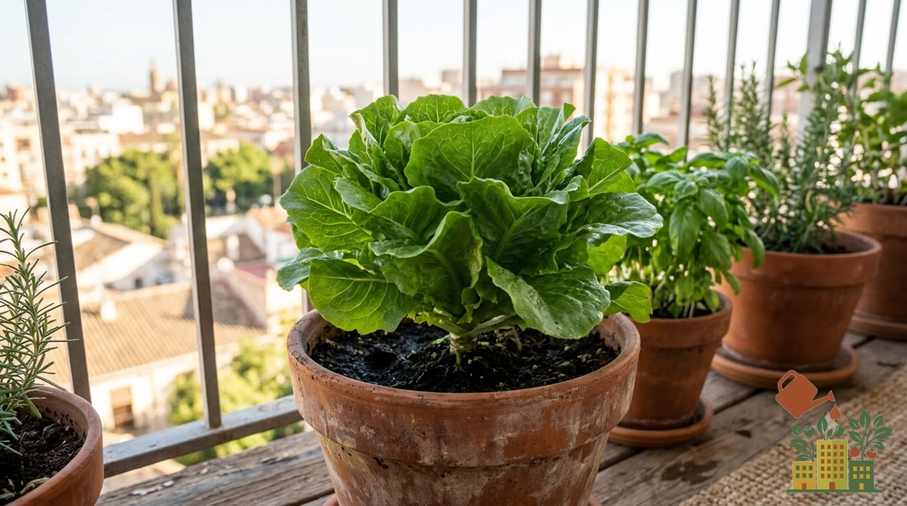

El otoño es la segunda gran ventana de siembra del año, después de la primavera, y suele estar algo más olvidada por quienes empiezan un huerto urbano. Aprovecharla bien permite mantener producción durante el otoño e invierno en lugar de dejar el huerto parado varios meses.

<figure><figcaption>Lechugas y hojas de otoño rinden muy bien tras el verano</figcaption></figure>

## Por qué merece la pena sembrar en otoño

Las temperaturas más suaves del otoño son ideales para muchas hortalizas de hoja, que en pleno verano se hubieran subido a flor prematuramente por el calor. Además, hay menos presión de ciertas plagas que son más activas en los meses cálidos.

## Qué sembrar en otoño

- **Espinacas**: uno de los cultivos que mejor rinde en esta época, consulta [cómo cultivar espinacas en maceta](/articulos/como-cultivar-espinacas-en-maceta/).
- **Lechugas de variedades de invierno**: eligiendo la variedad adecuada, se puede tener cosecha durante buena parte del invierno.
- **Rabanitos**: su ciclo corto permite aprovechar varias siembras escalonadas antes de que lleguen las heladas más fuertes.
- **Habas y [guisantes](/articulos/como-cultivar-guisantes-en-maceta/)**: toleran bien el frío moderado y se siembran típicamente en otoño para cosechar en invierno-primavera.
- **Ajos y cebollas**: cultivos de ciclo largo que se siembran en otoño para cosechar la temporada siguiente.

## El otoño en el interior va con prisa

En el interior peninsular el otoño es corto: se pasa del calor a las primeras heladas en pocas semanas. Con datos de AEMET para Toledo, la mínima media baja de 14,9 °C en septiembre a 5,3 °C en noviembre, y en noviembre ya hay de media unos 3 días de helada. Eso cambia el orden de siembra: primero lo que necesita tiempo para crecer antes del frío, y lo más rústico al final.

| Cuándo | Qué sembrar | Por qué en ese momento |
|---|---|---|
| Septiembre | Lechugas, espinacas, rabanitos, trasplante de coles y coliflor | Necesitan semanas de crecimiento antes de las heladas |
| Octubre | Habas, guisantes, más espinacas, canónigos | Toleran el frío moderado y arraigan antes del invierno |
| Octubre - noviembre | Ajos y cebollas | Pasan el invierno bajo tierra y arrancan en primavera |
| Noviembre | Solo cultivos muy rústicos (ajos, habas) | Con el sustrato frío, el resto apenas germina |

Si llegas tarde a una siembra, ponla en semillero dentro de casa o bajo un [mini invernadero](/articulos/mini-invernadero-balcon-mejores-opciones/) y trasplanta cuando tenga unas hojas.

## Preparar el sustrato tras el verano

El verano suele dejar el sustrato bastante agotado de nutrientes, especialmente en macetas que han tenido cultivos exigentes como tomates o pimientos. Antes de la siembra de otoño es buen momento para renovar total o parcialmente el [sustrato](/articulos/mejor-sustrato-huerto-urbano-maceta/), o al menos incorporar compost o [abono orgánico](/articulos/mejores-fertilizantes-organicos-huerto-maceta/).

## Protección frente a las primeras bajadas de temperatura

En zonas con heladas tempranas, ten preparado algún sistema de protección (mantas térmicas ligeras, [mini invernaderos de balcón](/articulos/mini-invernadero-balcon-mejores-opciones/)) para las primeras olas de frío del otoño, que a veces llegan antes de lo esperado.

## Riego en otoño

Aunque la necesidad de agua baja respecto al verano, no hay que descuidar el riego: revisa el sustrato con la misma regularidad, ajustando la frecuencia a la baja según vayan bajando las temperaturas. Consulta el [calendario de siembra completo](/articulos/calendario-siembra-completo-mes-a-mes/) para planificar el resto del año una vez tengas la siembra de otoño en marcha.

## Fuentes

- AEMET, [valores climatológicos normales de Toledo](https://www.aemet.es/es/serviciosclimaticos/datosclimatologicos/valoresclimatologicos?l=3260B&k=clm) (1981-2010).
