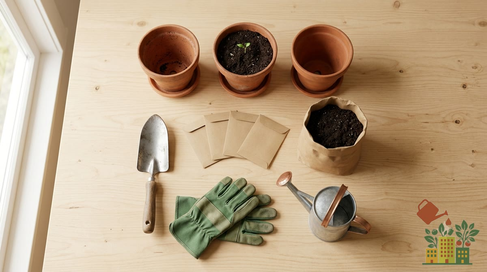

Si tienes que hacer un regalo a alguien con huerto en el balcón (o con ganas de empezarlo), lo más seguro es elegir **algo que le facilite el primer paso o que le resuelva un problema que ya tiene**: regar sin pasarse, proteger las plantas del frío o tener luz en invierno. Aquí tienes las ideas ordenadas de detalle pequeño a regalo grande, todas sacadas de las comparativas que ya tenemos en la web.

<figure><figcaption>Un kit para empezar es el regalo más seguro para quien todavía no cultiva nada</figcaption></figure>

*Este artículo contiene enlaces de afiliado. Si compras a través de ellos, podemos recibir una pequeña comisión sin coste adicional para ti. Los precios cambian a menudo, sobre todo en estas fechas: compruébalo en el botón antes de decidir.*

## Detalles pequeños (lo más económico)

### Medidor de humedad de la tierra

El error más común en el balcón es **regar de más**. Una sonda analógica se clava en la maceta y dice si la tierra está seca, húmeda o encharcada. No necesita pilas y es de lo más barato de esta lista. Las opciones, en [mejores medidores de humedad de la tierra](/articulos/mejores-medidores-humedad-tierra-macetas/).

<a href="https://www.amazon.es/s?k=medidor+humedad+tierra+sonda&tag=mihuerto-herramientas-21" target="_blank" rel="sponsored noopener" class="btn-primary not-prose inline-block no-underline">Ver precio en Amazon</a>

### Semilleros para empezar en casa

Bandejas de alveolos o pastillas de turba prensada para que pueda empezar sus propias plantas a finales de invierno. Un regalo que se usa justo cuando llega la temporada de siembra. Comparamos los tipos en [mejores semilleros para empezar plantas en casa](/articulos/mejores-semilleros-empezar-plantas-casa/).

<a href="https://www.amazon.es/s?k=bandeja+alveolos+semillero+plastico&tag=mihuerto-herramientas-21" target="_blank" rel="sponsored noopener" class="btn-primary not-prose inline-block no-underline">Ver precio en Amazon</a>

### Velo antiheladas

Para quien tiene el balcón expuesto al frío: un velo fino protege hojas y semilleros en las noches de helada. Útil en diciembre y enero, justo cuando lo va a recibir. Cómo elegir el grosor, en [mejores mallas antiheladas](/articulos/mejores-mallas-antiheladas-proteccion-invierno/).

<a href="https://www.amazon.es/s?k=velo+antiheladas+plantas&tag=mihuerto-herramientas-21" target="_blank" rel="sponsored noopener" class="btn-primary not-prose inline-block no-underline">Ver precio en Amazon</a>

## Regalos medianos

### Kit de huerto para principiantes

El regalo estrella para quien quiere empezar: maceta, sustrato y semillas en una sola caja. Si nunca ha cultivado nada, **el de aromáticas** es el que menos falla; si quiere hortalizas y le da miedo el riego, **uno con maceta autorregante**. Todos los tipos, en [mejores kits de huerto urbano para principiantes](/articulos/mejores-kits-huerto-urbano-principiantes/).

<a href="https://www.amazon.es/s?k=kit+huerto+urbano+aromaticas+principiantes&tag=mihuerto-herramientas-21" target="_blank" rel="sponsored noopener" class="btn-primary not-prose inline-block no-underline">Ver kits de aromáticas</a>

<a href="https://www.amazon.es/s?k=kit+huerto+urbano+maceta+autorregante&tag=mihuerto-herramientas-21" target="_blank" rel="sponsored noopener" class="btn-primary not-prose inline-block no-underline">Ver kits con maceta autorregante</a>

### Macetas autorregantes

Llevan un depósito de agua que compensa los olvidos y los fines de semana fuera. Ideales para quien ya cultiva pero no siempre llega a regar a tiempo. Diferencias entre modelos, en [mejores macetas autorregantes para balcón](/articulos/mejores-macetas-autorregantes-balcon-comparativa/).

<a href="https://www.amazon.es/s?k=maceta+autorregante+peque%C3%B1a&tag=mihuerto-herramientas-21" target="_blank" rel="sponsored noopener" class="btn-primary not-prose inline-block no-underline">Ver precio en Amazon</a>

### Mini invernadero de sobremesa

Una bandeja con tapa transparente que guarda calor y humedad para que germinen las semillas. Va muy bien junto a un sobre de semillas o un kit de semillero. Más opciones, en [mini invernadero para balcón](/articulos/mini-invernadero-balcon-mejores-opciones/).

<a href="https://www.amazon.es/s?k=mini+invernadero+semillero+sobremesa&tag=mihuerto-herramientas-21" target="_blank" rel="sponsored noopener" class="btn-primary not-prose inline-block no-underline">Ver precio en Amazon</a>

### Lámpara LED de cultivo con temporizador

Para quien quiere seguir con aromáticas o semilleros dentro de casa en invierno, cuando la luz de la ventana se queda corta. Las de sobremesa con temporizador son las más sencillas de usar. Las comparamos en [mejores luces LED de cultivo para huerto interior](/articulos/mejores-luces-led-cultivo-interior/).

<a href="https://www.amazon.es/s?k=lampara+led+cultivo+con+temporizador&tag=mihuerto-herramientas-21" target="_blank" rel="sponsored noopener" class="btn-primary not-prose inline-block no-underline">Ver precio en Amazon</a>

### Compostador bokashi de cocina

Un cubo cerrado para aprovechar los restos de cocina sin malos olores y convertirlos en abono para las macetas. Buen regalo para quien ya cultiva y le interesa reciclar. Las opciones, en [compostador de balcón: mejores opciones](/articulos/compostador-de-balcon-mejores-opciones/).

<a href="https://www.amazon.es/s?k=compostador+bokashi+cocina&tag=mihuerto-compost-21" target="_blank" rel="sponsored noopener" class="btn-primary not-prose inline-block no-underline">Ver precio en Amazon</a>

## Regalos grandes (solo si tiene sitio)

Antes de elegir uno de estos, asegúrate de que **cabe en su balcón** y de que le da la luz suficiente: son los que más espacio ocupan.

### Invernadero de estantería

Una estantería de varias baldas con funda de PVC: protege del frío y del viento y permite adelantar los semilleros. Medidas y consejos, en [mini invernadero para balcón](/articulos/mini-invernadero-balcon-mejores-opciones/).

<a href="https://www.amazon.es/s?k=invernadero+estanteria+cubierta+pvc+balcon&tag=mihuerto-herramientas-21" target="_blank" rel="sponsored noopener" class="btn-primary not-prose inline-block no-underline">Ver precio en Amazon</a>

### Kit de huerto vertical

Para balcones estrechos: aprovecha la pared o la barandilla en lugar del suelo. Lo explicamos en [mejores kits de huerto urbano para principiantes](/articulos/mejores-kits-huerto-urbano-principiantes/).

<a href="https://www.amazon.es/s?k=kit+huerto+vertical+principiantes&tag=mihuerto-herramientas-21" target="_blank" rel="sponsored noopener" class="btn-primary not-prose inline-block no-underline">Ver precio en Amazon</a>

### Vermicompostador

Compost con lombrices, para quien quiere producir su propio humus en casa. Es un regalo para alguien con interés de verdad, porque hay que cuidarlo. Cómo funciona, en [compostador de balcón: mejores opciones](/articulos/compostador-de-balcon-mejores-opciones/).

<a href="https://www.amazon.es/s?k=vermicompostador+lombrices+balcon&tag=mihuerto-compost-21" target="_blank" rel="sponsored noopener" class="btn-primary not-prose inline-block no-underline">Ver precio en Amazon</a>

### Sensor de humedad wifi

Se queda clavado en la maceta y **avisa al móvil** cuando la tierra está seca. Para quien viaja a menudo o tiene muchas macetas. Más detalles, en [mejores medidores de humedad de la tierra](/articulos/mejores-medidores-humedad-tierra-macetas/).

<a href="https://www.amazon.es/s?k=sensor+humedad+plantas+wifi&tag=mihuerto-herramientas-21" target="_blank" rel="sponsored noopener" class="btn-primary not-prose inline-block no-underline">Ver precio en Amazon</a>

## Un regalo gratis: el calendario de siembra en PDF

Si quieres acompañar cualquiera de estos regalos con algo práctico, tenemos un **calendario de siembra para balcón e interior en PDF** que puedes descargar gratis, imprimir y meter en la caja. Así sabrá qué sembrar cada mes en cuanto lo abra. Lo tienes en el [calendario de siembra mes a mes](/articulos/calendario-siembra-completo-mes-a-mes/#calendario-pdf).

## Cómo acertar según la persona

- **No ha cultivado nunca**: kit de aromáticas o kit con maceta autorregante.
- **Ya cultiva, pero se le mueren por el riego**: medidor de humedad o macetas autorregantes.
- **Su balcón pasa frío**: velo antiheladas o invernadero de estantería.
- **Quiere seguir en invierno dentro de casa**: lámpara LED de cultivo.
- **Le gusta empezar desde semilla**: semilleros y mini invernadero de sobremesa.
- **Le interesa reciclar**: compostador bokashi o vermicompostador.

Y si el regalo es para ti y estás empezando, pásate antes por [cómo empezar un huerto urbano en el balcón](/articulos/como-empezar-huerto-urbano-balcon/) para saber qué necesitas de verdad.
