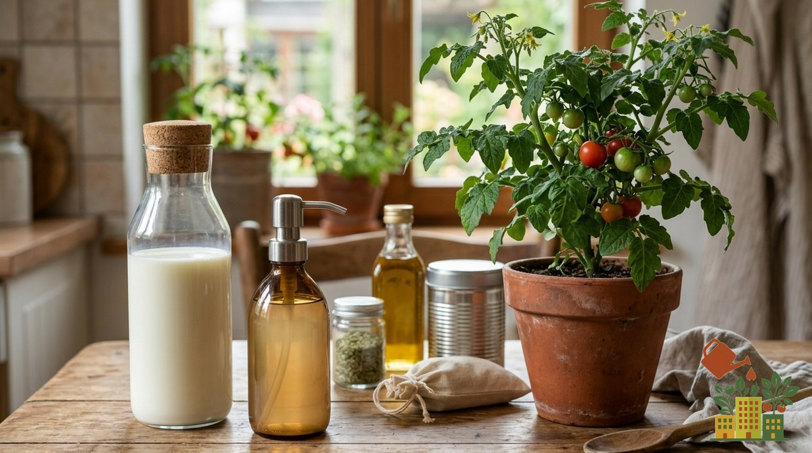

Los grupos de huerto están llenos de remedios caseros virales para las plagas. Algunos funcionan, pero **muchos no hacen nada… y unos cuantos dañan la planta**. Aquí tienes primero los remedios caseros que sí funcionan, con cómo prepararlos, y después los mitos que conviene evitar.

<figure><figcaption>No todo lo que se comparte en los grupos funciona: algunos remedios caseros dañan más que ayudan.</figcaption></figure>

## Qué remedio usar para cada plaga

| Plaga | Remedio casero que funciona | Frecuencia |
|---|---|---|
| Pulgón | Jabón potásico | Cada 3-5 días, 2-3 semanas |
| Mosca blanca | Jabón potásico + trampas amarillas | Cada 3-5 días |
| Araña roja | Jabón potásico y subir la humedad (pulverizar agua) | Cada 3 días |
| Cochinilla algodonosa | Bastoncillo con alcohol; neem si hay mucha | En cada revisión |
| Plagas que vuelven una y otra vez | Aceite de neem | Cada 7 días |
| Hormigas, babosas | Tierra de diatomeas (en seco) | Tras cada riego o lluvia |

## ✅ Los que sí funcionan (y cómo prepararlos)

**[Jabón potásico](/articulos/jabon-potasico-plagas-como-usarlo/).** Diluye jabón potásico puro en agua, normalmente 10-20 ml por litro (sigue siempre la dosis del envase), y pulveriza directamente sobre el pulgón, la mosca blanca o la [araña roja](/articulos/como-eliminar-arana-roja-plantas-balcon/), insistiendo en el envés. Actúa por contacto: si no moja al insecto, no hace nada.

**[Aceite de neem](/articulos/aceite-neem-huerto-como-usarlo/).** Repele e interfiere en el ciclo de muchos insectos. Se mezcla con un poco de jabón potásico para que se disuelva en el agua. Aplícalo siempre a primera o última hora del día para evitar quemaduras por sol.

**Alcohol para la cochinilla.** Un bastoncillo de algodón empapado en alcohol de farmacia aplicado sobre los grupos de [cochinilla algodonosa](/articulos/cochinilla-algodonosa-como-eliminarla-balcon/) los elimina uno a uno. Es lo más eficaz cuando la plaga está localizada.

**Trampas amarillas.** Una cartulina amarilla untada con un poco de vaselina, colgada junto a las plantas, atrapa mosca blanca y otros voladores. Además te sirve de alarma: si cada vez caen más, la plaga va a más. Tienes opciones ya hechas en [trampas cromáticas](/articulos/trampas-cromaticas-amarillas-plagas/).

**Macerado de ajo (repelente, no insecticida).** Tritura una cabeza de ajos, déjala 24 horas en un litro de agua, cuela y pulveriza. Ayuda a alejar algunos insectos por el olor, pero no elimina una plaga ya instalada: úsalo como prevención.

**Purín de ortiga (abono que fortalece).** Ortigas frescas fermentadas en agua una o dos semanas y diluidas antes de regar. Más que un insecticida es un abono: una planta bien nutrida resiste mejor, pero no esperes que acabe con el pulgón.

## Los que no funcionan (o dañan la planta)

### ❌ La leche contra la mosca blanca o el pulgón

Es de los más repetidos, pero **la leche no hace nada contra insectos**. La mezcla de leche y agua se usa a veces contra **hongos** (como el [oídio](/articulos/oidio-huerto-urbano-como-eliminarlo/)), con resultados discretos, pero contra la [mosca blanca](/articulos/como-eliminar-mosca-blanca-huerto-balcon/) o el [pulgón](/articulos/como-eliminar-pulgon-plantas-balcon-natural/) es tirar el tiempo.

**Qué usar:** jabón potásico y trampas amarillas.

### ❌ Jabón de vajilla o lavavajillas

"Échale Fairy" es un clásico. El problema: los detergentes de vajilla llevan **desengrasantes, sales y aditivos** que **queman las hojas** y dañan la planta. Puede que mate algún bicho, pero de paso castiga el cultivo.

**Qué usar:** [jabón potásico](/articulos/jabon-potasico-plagas-como-usarlo/), que es un jabón vegetal específico y seguro.

### ❌ Regar con agua de la lavadora

Muy mala idea. Lleva **detergente, suavizante y a veces lejía**: sales y químicos que se acumulan en la tierra, **dañan las raíces** y pueden matar la planta a medio plazo.

**Qué usar:** agua normal, y si quieres reaprovechar, solo agua de aclarar verduras o de cocer (sin sal).

### ❌ El culo negro se cura fumigando

La mancha marrón hundida en tomate o pimiento (**[culo negro](/articulos/culo-negro-tomate-podredumbre-apical/)**) no es un hongo ni una plaga: es calcio que no llega al fruto por **riego irregular**. Fumigar con leche, fungicida o lo que sea **no lo cura**.

**Qué hacer:** riego constante y acolchado.

### ❌ Ajo, vinagre o bicarbonato "para todo"

Tienen algún uso puntual (el bicarbonato ayuda algo con hongos; el ajo repele levemente), pero **no son la solución universal** que se vende, y el **vinagre puro quema** las hojas y acidifica la tierra si te pasas.

## Cuándo un remedio casero no es suficiente

Si tras 2-3 semanas aplicando el remedio adecuado la plaga sigue avanzando, revisa primero el diagnóstico: unas [manchas blancas en las hojas](/articulos/manchas-blancas-hojas-plantas-que-son/) pueden ser hongo y no insecto, y entonces ningún insecticida sirve. La prevención es lo más rentable a largo plazo: lo tienes en [prevenir plagas sin pesticidas](/articulos/como-prevenir-plagas-huerto-urbano-sin-pesticidas/), y la [tierra de diatomeas](/articulos/tierra-diatomeas-huerto/) para hormigas y babosas.

Antes de echarle algo a tu planta por lo que viste en un grupo, comprueba si de verdad funciona: a veces el "remedio" hace más daño que la plaga. Tienes la selección completa en la [comparativa de productos ecológicos contra plagas](/articulos/mejores-productos-ecologicos-contra-plagas-huerto/).
